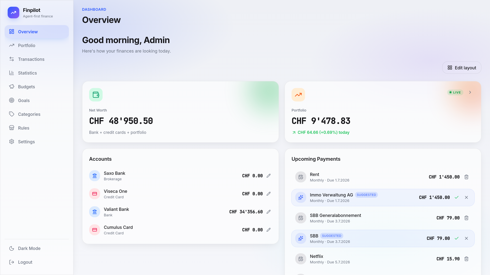
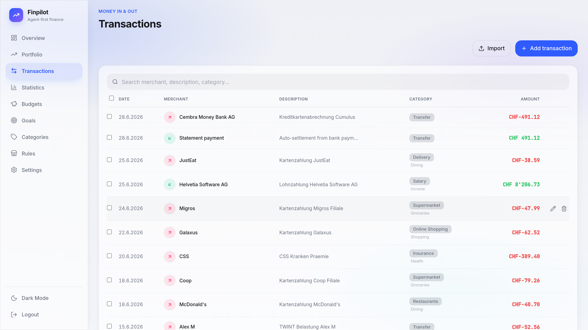
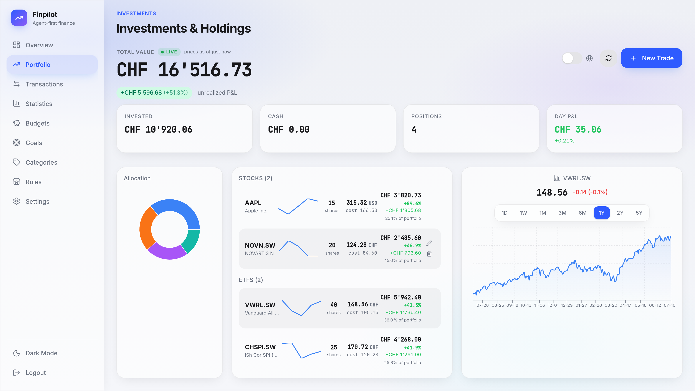
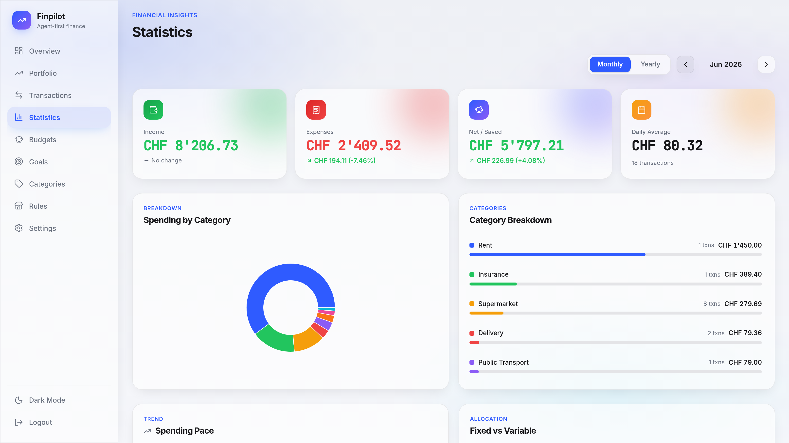
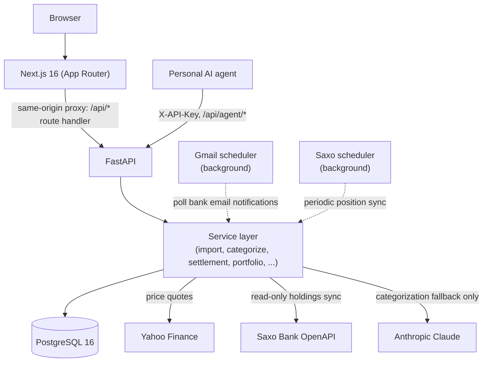

# FinPilot

**Self-hosted personal finance tracking, built around Swiss e-banking.**

[](https://github.com/Pineacles/finpilot/actions/workflows/ci.yml)
[](LICENSE)


FinPilot imports your bank's e-banking exports and categorizes every
transaction, and gets better each time you correct it. It keeps a lean view
of your ETF and stock holdings with honest pricing (stale quotes and failed FX
lookups are flagged, never papered over), and exposes a small,
key-authenticated API so a personal AI agent can read your financial state and
fix data mistakes, with no access to anything else.

It runs my own household's finances daily. If you're here to read code, start
with [Architecture](#architecture) and the import pipeline under
[Features](#features).

## Screenshots


Dashboard: net worth, live portfolio value, accounts, and upcoming payments.


Transactions: imported and categorized Swiss bank and card activity.


Portfolio: stock and ETF holdings with live prices and performance.


Statistics: monthly income, expenses, and spending by category.

## Features

- **Bank statement import**: camt.053 XML (ISO 20022), Valiant/PostFinance/Viseca
  CSV, plus a generic column-mapper for anything else, all with automatic dedup.
- **Auto-categorization that learns**: keyword rules → merchant database →
  transaction history → a per-user ML classifier, falling back to Claude only
  for genuine unknowns (and only if you configure an API key).
- **Cumulus settlement auto-reset**: detects the monthly Migros Cumulus
  (Cembra) card-bill payment on the linked bank account and resets the credit
  card balance to zero, idempotently, so re-importing the same statement is a
  no-op.
- **Holdings-only portfolio**: current ETF/stock positions with live pricing,
  a staleness indicator, and explicit FX-rate warnings instead of silent
  fallbacks. No AI stock analysis or trade recommendations: that experiment
  was tried, didn't work, and was removed.
- **Selective watchlist**: track a handful of tickers (price + day change)
  without implying you hold them or want advice on them.
- **Customizable dashboard**: a widget registry with per-user visibility and
  ordering.
- **Recurring-payment detection**: surfaces subscriptions and bills from
  transaction history with an upcoming-payments view.
- **Budgets & savings goals**: simple caps and targets checked against real
  transaction data.
- **Read-only Saxo Bank sync**: pulls real brokerage positions in without any
  order-placement capability.
- **Agent gateway**: a thin, `X-API-Key`-authenticated API surface so a
  personal AI agent can read financial state and fix data mistakes (merchant
  renames, recategorization, corrections) without touching the database
  directly.

## Architecture



The frontend never calls the backend cross-origin: `frontend/src/app/api/[...path]/route.ts`
proxies same-origin requests to the FastAPI service, so the browser only ever
talks to Next.js. Two background schedulers run inside the API process:
`services/gmail_scheduler.py` (polls for bank email notifications) and
`services/saxo_scheduler.py` (periodic read-only position sync), both started
in `app/main.py`'s lifespan handler.

## Tech stack

| Layer | Technology |
|---|---|
| Frontend | Next.js 16 (App Router), TypeScript, Tailwind CSS, TanStack Query, Recharts |
| Backend | FastAPI, Python 3.12, SQLAlchemy (async), Alembic |
| Database | PostgreSQL 16 |
| Auth | JWT (PyJWT) for the dashboard, `X-API-Key` for agent endpoints |
| ML | scikit-learn (per-user TF-IDF + SGD categorization classifier), `thefuzz` for merchant matching |
| External data | Yahoo Finance (quotes), Saxo Bank OpenAPI (read-only sync), Anthropic Claude (categorization fallback) |
| Infra | Docker Compose |

## Quickstart

### Prerequisites

- Docker & Docker Compose
- Python 3.12+ (local backend dev only)
- Node 20+ (local frontend dev only)

### 1. Clone and configure

```bash
git clone https://github.com/your-org/finpilot.git
cd finpilot
cp .env.example .env
```

Edit `.env`, at minimum setting `SECRET_KEY` and `POSTGRES_PASSWORD`:

```bash
# Generate a strong key:
python3 -c "import secrets; print(secrets.token_urlsafe(48))"
```

### 2. Start

```bash
docker compose up -d
```

The `api` container runs `alembic upgrade head` automatically on boot (see
[`backend/MIGRATIONS.md`](backend/MIGRATIONS.md) if you're migrating an
existing pre-Alembic database rather than starting fresh).

| Service | Default URL |
|---|---|
| Web (Next.js) | http://localhost:3010 |
| API (FastAPI) | http://localhost:8001 |
| API docs | http://localhost:8001/docs *(dev only, disabled when `ENVIRONMENT=production`)* |

### 3. Seed a user

```bash
SEED_EMAIL=you@example.com SEED_PASSWORD=changeme \
  docker compose exec api python seed.py
```

Add `--demo` to also generate ~6 months of deterministic, entirely fake demo
data (salary/rent/groceries/insurance, a full Cumulus settlement cycle, a
small ETF/stock portfolio, budgets, a savings goal, recurring expenses, and a
watchlist) so every feature has something to show:

```bash
docker compose exec api python seed.py --demo
```

## Environment variables

All variables are documented in [`.env.example`](.env.example).

| Variable | Required | Default | Description |
|---|---|---|---|
| `SECRET_KEY` | **yes** | none | JWT signing key (≥ 32 chars) |
| `POSTGRES_PASSWORD` | **yes** | none | Postgres password |
| `POSTGRES_USER` / `POSTGRES_DB` | no | `finpilot` | Postgres user/database name |
| `DB_PORT` / `API_PORT` / `WEB_PORT` | no | `5432` / `8001` / `3010` | Host ports for Compose |
| `ENVIRONMENT` | no | `development` | Set to `production` to disable `/docs` |
| `CORS_ORIGINS` | no | `http://localhost:3000,http://localhost:3010` | Allowed CORS origins |
| `ANTHROPIC_API_KEY` | no | none | Enables the AI fallback step of transaction categorization |
| `ANALYSIS_MODEL` | no | `claude-sonnet-4-20250514` | Model used for the categorization fallback |

See `.env.example` for the full, current list.

## Testing

```bash
cd backend
python -m venv .venv && source .venv/bin/activate
pip install -r requirements.txt
pytest tests/ -x -q
```

Tests run fully offline against an in-memory SQLite database: no Postgres,
network access, or Anthropic API key required. CI (`.github/workflows/ci.yml`)
runs this suite against Postgres on every push/PR, plus a frontend type-check
and production build.

```bash
cd frontend
npm ci
npx tsc --noEmit
npm run build   # production build
npm run dev     # dev server on :3000
```

## Database migrations

```bash
docker compose exec api alembic upgrade head
```

See [`backend/MIGRATIONS.md`](backend/MIGRATIONS.md) for the baseline
reconstruction history and which path applies to an existing database.

## Agent API

External AI agents authenticate with the `X-API-Key` header (issued per-user
by `seed.py`, or visible in account settings). All agent endpoints live under
`/api/agent/*` and share the same service layer as the dashboard, so behavior
can't drift between the two. See the API docs (dev only) or
[`backend/app/api/endpoints/agent.py`](backend/app/api/endpoints/agent.py) /
[`agent_finance_router.py`](backend/app/api/endpoints/agent_finance_router.py) /
[`agent_portfolio_router.py`](backend/app/api/endpoints/agent_portfolio_router.py)
for the route map.

## License

[MIT](LICENSE)
