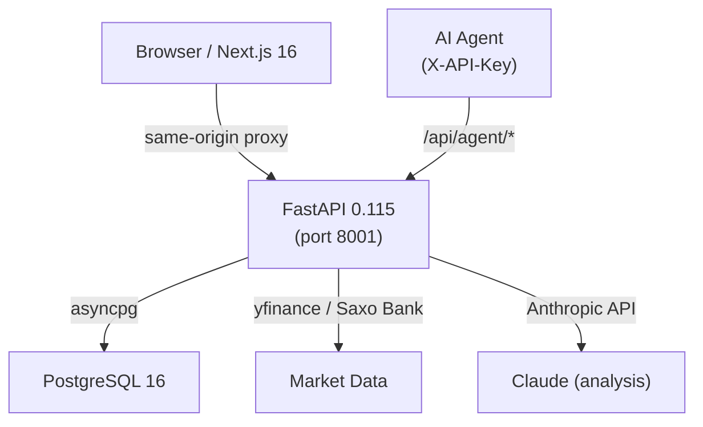

# FinPilot

Personal finance dashboard with AI-assisted analysis, portfolio tracking, and automated bank-statement import.


## Architecture



## Tech stack

| Layer | Technology |
|---|---|
| Frontend | Next.js 16 (App Router), TypeScript, Tailwind CSS, Recharts |
| Backend | FastAPI 0.115, Python 3.12, SQLAlchemy async, Alembic |
| Database | PostgreSQL 16 |
| Auth | JWT (PyJWT ≥ 2.8) + X-API-Key for agent endpoints |
| Infra | Docker Compose |

## Quickstart

### Prerequisites

- Docker & Docker Compose
- Python 3.12+ (for local backend dev only)
- Node 20+ (for local frontend dev only)

### 1. Clone and configure

```bash
git clone https://github.com/your-org/finpilot.git
cd finpilot
cp .env.example .env
```

Edit `.env` — at minimum set:

```bash
# Generate a strong key:
python3 -c "import secrets; print(secrets.token_urlsafe(48))"
```

Set `SECRET_KEY`, `POSTGRES_PASSWORD`, and any broker credentials you need.

### 2. Start

```bash
docker compose up -d
```

Services:

| Service | Default URL |
|---|---|
| Web (Next.js) | http://localhost:3010 |
| API (FastAPI) | http://localhost:8001 |
| API docs | http://localhost:8001/docs *(dev only)* |

### 3. Seed the first user

```bash
SEED_EMAIL=you@example.com SEED_PASSWORD=changeme \
  docker compose exec api python seed.py
```

## Environment variables

All variables are documented in [`.env.example`](.env.example).

| Variable | Required | Default | Description |
|---|---|---|---|
| `SECRET_KEY` | **yes** | — | JWT signing key (≥ 32 chars) |
| `POSTGRES_PASSWORD` | **yes** | — | Postgres password |
| `ENVIRONMENT` | no | `development` | Set to `production` to disable `/docs` |
| `CORS_ORIGINS` | no | `http://localhost:3000,http://localhost:3010` | Allowed CORS origins |
| `GUARDRAIL_ADMIN_NAME` | no | *(empty)* | Display name allowed to bypass tool-weight guardrails |
| `NEXT_PUBLIC_ADMIN_NAME` | no | `admin` | Audit-trail label for proposal resolutions |
| `ANTHROPIC_API_KEY` | no | — | Required for AI analysis features |
| `SAXO_APP_KEY` | no | — | Saxo Bank broker integration |
| `VISECA_USERNAME` | no | — | Viseca One card sync |

See `.env.example` for the full list.

## Development

### Backend

```bash
cd backend
python -m venv .venv && source .venv/bin/activate
pip install -r requirements.txt
# Run tests
pytest tests/ -x -q
```

### Frontend

```bash
cd frontend
npm ci
npm run build   # production build
npm run dev     # dev server on :3000
```

### Database migrations

```bash
docker compose exec api alembic upgrade head
```

## Agent API

External AI agents authenticate with the `X-API-Key` header.  
All agent endpoints live under `/api/agent/*`.  
See the API docs (dev only) or [`backend/app/api/endpoints/agent.py`](backend/app/api/endpoints/agent.py) for the route map.

## Screenshots

*(Add screenshots here)*

## License

[MIT](LICENSE)
