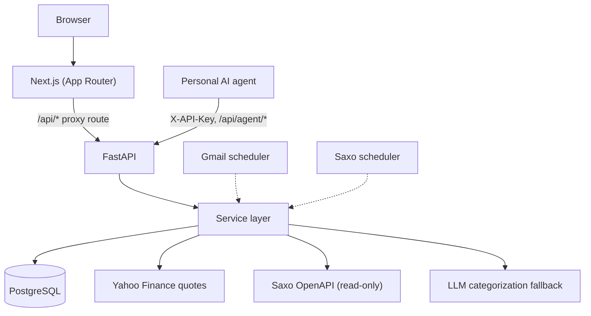

# Architecture

## Overview

The browser only talks to Next.js. `frontend/src/app/api/[...path]/route.ts` proxies same-origin
requests to the API, so there is no cross-origin traffic. Route handlers in
`backend/app/api/endpoints/` are thin; the logic lives in `backend/app/services/`, which both the
dashboard routes and the agent routes call, so the two cannot drift. Two background schedulers
(Gmail poll, Saxo sync) start in the FastAPI lifespan handler in `app/main.py`.

## Backend layout

- `api/endpoints/`: `auth`, `dashboard` (overview, accounts), `transactions`, `finance` (budgets,
  goals, milestones, recurring, cashflow), `portfolio`, `watchlist`, `merchants`, `categorize`,
  `csv_import`, `stats`, `sync`, `brokers` (Saxo), `user_settings`, `portfolio_sharing`
  (public share), `docs` and the three `agent*` routers.
- `services/`: import parsers (`csv_import`, `camt053`, `pdf_import`, `mapped_import`),
  categorization (`categorize`, `classifier`, `merchant_service`, `seed_merchants`), `settlement`,
  `recurring_detection`, `portfolio_service`, `prices`, `currency`, `classification`,
  `stats_service`, `budget_service`, `gmail_poller`, `url_guard`, `settings`.
- `brokers/`: a small adapter interface and registry; `saxo/` holds the OAuth, client, mapping
  and sync code.
- `core/`: settings, async DB session, password hashing and JWT, Fernet encryption for stored
  secrets, trusted client-IP resolution for rate limiting.

## Data model

Every table is scoped to a user.

| Table | Purpose |
|---|---|
| `users` | Login, API key, base currency, public-portfolio token |
| `accounts` | Bank, credit card and brokerage accounts; credit cards carry settlement patterns |
| `transactions` | Imported or manual entries with category, merchant, bank reference |
| `categories` | Per-user category tree |
| `merchants`, `categorization_log` | Merchant rules and a record of how each transaction was categorized |
| `budgets`, `savings_goals`, `milestones`, `recurring_expenses` | Planning data |
| `stock_positions`, `stock_transactions`, `portfolio_snapshots` | Holdings, trades, value history |
| `symbol_classifications` | Asset type per symbol (auto, user or agent override) |
| `watchlist_items` | Tracked tickers |
| `import_profiles` | Saved column mappings for generic CSV import |
| `user_settings` | Per-user key/value settings; sensitive values are encrypted at rest |
| `sync_logs` | Status of Gmail and Saxo syncs |

Schema changes go through Alembic (`backend/alembic/versions`, notes in
`backend/MIGRATIONS.md`).

## Categorization pipeline

Keyword rules, merchant table, past transactions, per-user classifier, and only then the LLM.
Each step records its source in `categorization_log`, and manual corrections feed the merchant
table and classifier.

## Frontend

Routes: `/` (widget dashboard), `/portfolio`, `/transactions`, `/stats`, `/budgets`, `/goals`,
`/categories`, `/merchants`, `/settings` (including the Saxo OAuth callback), `/login`, and
`/p/[token]` for the public portfolio view. Server state goes through TanStack Query hooks in
`src/hooks/queries.ts`.

## Security notes

Ports bind to loopback by default, login and sensitive routes are rate limited using a
trusted-proxy-aware client IP, user-supplied AI and search URLs pass an SSRF guard, and stored
Gmail and Saxo credentials are encrypted with `TOKEN_ENCRYPTION_KEY` when it is set.
